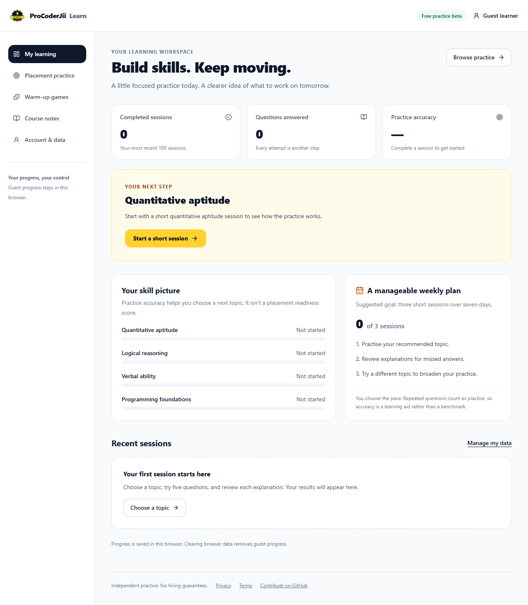

<div align="center">


# ProCoderJii Learning Hub

### Practise for campus placements. Understand your answers. Build a study habit.

A student learning workspace with original practice questions, explanations, and saved progress.

[Website](https://procoderji.com) · [Documentation](docs/README.md) · [Roadmap](https://github.com/procoderji-com/procoderji/issues/22) · [Good first issues](https://github.com/procoderji-com/procoderji/issues?q=is%3Aissue%20is%3Aopen%20label%3A%22good%20first%20issue%22) · [Report a bug](https://github.com/procoderji-com/procoderji/issues/new?template=bug_report.yml) · [Propose a question](https://github.com/procoderji-com/procoderji/issues/new?template=practice_question.yml)

[](https://github.com/procoderji-com/procoderji/actions/workflows/ci.yml)
[](LICENSE)
[](https://nextjs.org/)
[](https://www.typescriptlang.org/)
[](https://github.com/procoderji-com/procoderji/issues?q=is%3Aissue%20is%3Aopen%20label%3A%22good%20first%20issue%22)

</div>

> [!NOTE]
> This is an early student-product foundation. Four practice topics contain 24 original multiple-choice questions. Practice and browser-saved progress work without login. An optional ASP.NET Core backend provides Google sign-in and account progress when configured. Billing and checkout are not enabled. Course notes, guides, and job listings are still awaiting published content.



See the [product roadmap](docs/product-roadmap.md) for student validation, content growth, and future monetization work.

## Contents

- [Student experience](#student-experience)
- [Progress and optional accounts](#progress-and-optional-accounts)
- [Current content](#current-content)
- [Getting started](#getting-started)
- [Commands and CI](#commands-and-ci)
- [Project structure](#project-structure)
- [Contributing](#contributing)
- [Privacy and security](#privacy-and-security)
- [License and attributions](#license-and-attributions)

## Student experience

ProCoderJii helps engineering students practise placement skills in short sessions and learn from
their answers. Run the app locally to explore the implemented routes:

| Route | What it provides |
| --- | --- |
| `/learn` | A learner workspace with practice history, topic progress, and a suggested next step. |
| `/practice` | Quantitative aptitude, logical reasoning, verbal ability, and programming foundations. |
| `/practice/[topic]` | Multiple-choice practice sessions with scores, correct answers, and explanations. |
| `/games` | Pattern Sprint and Digit Recall: short reasoning and memory exercises. |
| `/account` | Optional Google sign-in and cloud progress controls when the backend is configured. |
| `/dashboard` | Engineering course, branch, and semester navigation for future reviewed notes. |

Questions are original learning exercises. They are independent of employer assessments and do
not predict or guarantee hiring outcomes. The first question bank is intentionally small so it
can be reviewed and improved before expanding.

## Progress and optional accounts

Anonymous practice saves the latest **100 completed attempts** in the current browser. The
learner workspace derives results from answers and the current question bank. Clearing browser
site data removes that local history, and browser-only progress does not travel between devices.

The optional **ASP.NET Core 10** backend provides Google sign-in and account progress through
the frontend's same-origin API. Account progress is kept separate from guest progress. The
backend authenticates requests, validates attempts against the shared question bank, and stores
each student's own history with Entity Framework Core. See [Backend setup](backend/README.md)
for local persistence, Google credentials, and production integration checks.

The free practice flow works without provider credentials. Paid plans, payment processing, and
commercial account entitlements require separate product and provider decisions; this repository
does not currently enable them.

## Current content

| Area | Status |
| --- | --- |
| Placement practice | 24 questions across four topics, explanations, and saved session history. |
| Short games | Pattern Sprint and Digit Recall are playable without login; their scores are not saved. |
| Course catalogue | Course, branch, and semester navigation exists; no subjects or notes are published yet. |
| Guides | No reviewed guides published yet. |
| Jobs and internships | No reviewed listings published yet. |
| Latest videos | Optional public YouTube channel feed. |

Sample notes under `src/content` are intentionally unregistered. Follow the
[content guide](docs/content-guide.md) before publishing learning material. The
[roadmap](https://github.com/procoderji-com/procoderji/issues/22) records longer-term priorities.

## Getting started

Use Node.js **24**, npm, and Google Chrome for frontend browser checks. `.nvmrc` and
`.node-version` record the supported Node major. Install the **.NET 10 SDK** when working on the
backend or enabling account synchronization.

```bash
git clone https://github.com/procoderji-com/procoderji.git
cd procoderji
npm ci
npm run dev
```

Open <http://localhost:3000>. No environment file is needed for practice and local progress.
External contributors should follow the [fork workflow](CONTRIBUTING.md#set-up-your-fork).

Copy `.env.example` to `.env.local` only when enabling optional services:

| Variable | Purpose |
| --- | --- |
| `YOUTUBE_CHANNEL_ID` | Public channel ID for latest-video cards. |
| `NEXT_PUBLIC_SITE_URL` | Canonical site URL override, such as a staging origin. |
| `DOTNET_API_URL` | Optional server-only backend origin, such as `http://localhost:5100`. |

Google credentials belong in the backend's user-secrets or environment configuration, never in
browser variables. Use the [development guide](docs/development.md) for setup and
troubleshooting, [backend guide](backend/README.md) for accounts, and
[deployment guide](docs/deployment.md) for hosting.

## Commands and CI

| Command | Purpose |
| --- | --- |
| `npm run dev` | Start the local development server. |
| `npm run lint` | Run ESLint. |
| `npm run typecheck` | Check TypeScript types. |
| `npm test` | Run unit tests, including practice-domain, progress-model/store, and content-validation tests. |
| `npm run build` | Create the production build. |
| `npm run e2e` | Build with synthetic content and check frontend browser behavior; opt into the backend with `E2E_DOTNET=1`. |
| `npm run launch-check` | Build the real site and crawl links, sitemap, metadata, and SEO rules. |
| `dotnet test backend/ProCoderJi.slnx --configuration Release` | Run backend integration and validation tests. |

| CI job | Coverage |
| --- | --- |
| Lint, typecheck, tests and build | TypeScript, code quality, domain/store tests, and the production build. |
| Browser and SEO checks | Desktop/mobile flows, a real .NET process and frontend proxy, the Google sign-in challenge, and a crawl of links/metadata. |
| Backend build and tests | The .NET solution build and tests for backend rules and access behavior. |

These jobs need no Google credentials or other external secrets. Browser screenshots are
retained for seven days when the site-quality job fails. A deployed Google sign-in flow still
needs the configured-provider checks in [Backend setup](backend/README.md). Browser CI verifies
the challenge and public callback URL with test client configuration; it does not complete real
Google consent or token exchange.

The E2E runner refuses to run when `src/data` or `src/content` has local changes because it
temporarily installs synthetic fixtures. See [Development](docs/development.md#checks).

## Project structure

```text
src/app/                Next.js routes, metadata, and backend-for-frontend API
src/features/practice/  Pure practice rules, question-bank adapter, and practice UI
src/features/progress/  Validated attempt records and browser progress storage
src/features/account/   Optional account-provider clients and controls
src/components/         Shared UI and landing-page sections
src/content/            Markdown and MDX learning content
src/data/               Course, guide, and job catalogues
src/lib/                Existing content, rendering, SEO, and game helpers
backend/                ASP.NET Core 10 API, EF persistence, and backend tests
shared/practice/        Canonical question JSON used by TypeScript and .NET
e2e/                    Browser checks, fixtures, and production crawl
docs/                   Development, architecture, content, and decision guides
.github/                CI, Dependabot, issue forms, and pull-request template
```

The Next.js frontend and .NET backend have clear boundaries in one repository. Read
[Architecture](docs/architecture.md) and [ADR 0001](docs/decisions/0001-student-product-boundaries.md)
for the boundaries between learning rules, UI, storage, and providers.

## Contributing

Start with [CONTRIBUTING.md](CONTRIBUTING.md) and the [documentation index](docs/README.md).
Check open issues before starting a larger feature and describe the student problem it solves.
Contributors are expected to follow the [Code of Conduct](CODE_OF_CONDUCT.md).

| Contribution | Start here |
| --- | --- |
| Original questions and explanations | [Question proposal](https://github.com/procoderji-com/procoderji/issues/new?template=practice_question.yml), then the [shared question bank](shared/practice/questions.json). |
| Scoring, validation, or recommendations | [Practice domain](src/features/practice/domain/) and its tests. |
| Saved progress behavior | [Progress feature](src/features/progress/) and its model/store tests. |
| Student interface and accessibility | [Practice views](src/features/practice/client/) and shared components. |
| Optional accounts, synchronization, or persistence | [Backend setup](backend/README.md), [account feature](src/features/account/), and the Next.js `/api/platform/*` proxy. |
| Original notes, guides, and listings | [Content guide](docs/content-guide.md). |
| Setup and contributor guidance | `docs/` and the [contribution guide](CONTRIBUTING.md). |

Submit original material or link to official sources. Do not copy notes, question banks, job
descriptions, papers, or images without permission. Optional coding-agent tools and their
upstream notices are documented in [docs/agent-tools.md](docs/agent-tools.md) and
[THIRD_PARTY_NOTICES.md](THIRD_PARTY_NOTICES.md).

## Privacy and security

Read the site's [privacy policy](https://procoderji.com/privacy) for data handling. Report
vulnerabilities privately using [SECURITY.md](SECURITY.md).

## License and attributions

The project is available under the [MIT License](LICENSE). Vendored agent tools retain their
separate upstream notices; see [THIRD_PARTY_NOTICES.md](THIRD_PARTY_NOTICES.md).
