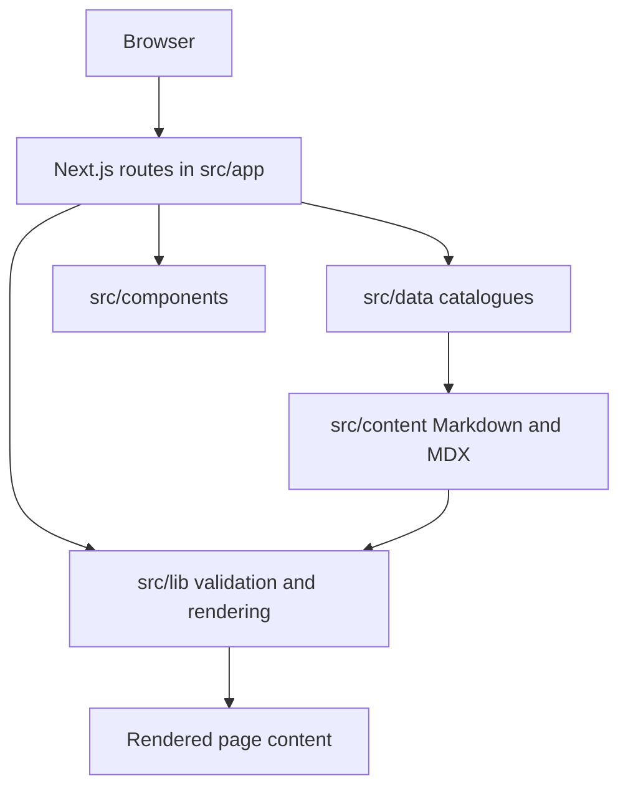

# Architecture

This project is a content-driven Next.js App Router site. Most pages are generated from files in
the repository at build time. There is no database or account system.

## Request and content flow

Course notes, guides and jobs use JSON catalogues that point to content files. Only entries in a
catalogue are published. Validation checks slugs, dates and file paths before content is used.
The note renderer accepts a safe Markdown subset; it rejects raw HTML, JSX, expressions and
imports. See [the content guide](content-guide.md) for authoring details.

## Main areas

| Path | Responsibility |
| --- | --- |
| `src/app/` | Routes, metadata, page layouts and sitemap/robots endpoints |
| `src/components/` | Shared site shell, landing-page sections, cards and reader UI |
| `src/content/` | Note and guide files |
| `src/data/courses.json` | Course, branch, semester, subject and unit catalogue |
| `src/data/guides.json` | Guide catalogue |
| `src/data/jobs.json` | Hand-curated job and internship catalogue |
| `src/lib/` | Validation, safe paths, Markdown parsing, dates, metadata and game logic |
| `e2e/` | Browser interactions, temporary fixtures and production crawl checks |
| `docs/` | Contributor, content, security and deployment documentation |
| `.agents/` | Optional coding-agent skills; see [agent tools](agent-tools.md) |
| `.claude/` | Pointers to the canonical copies under `.agents/skills/` |

The old `/courses/*` routes are retained as redirects to `/dashboard/*`; new course work should
use the dashboard routes.

## Games

The games hub and individual games live under `src/app/games/`. Game components own their
temporary round state in the browser. Shared question data and digit generation live in
`src/lib/games.ts`; unit tests cover the generated content. Scores are not sent to a server or
saved between visits.

## Rendering and search indexing

- Content pages are included in the sitemap only when their referenced file can be read.
- Empty course sections are marked `noindex` and are omitted from the sitemap.
- Site-wide metadata and canonical URLs are built from `NEXT_PUBLIC_SITE_URL`, which defaults to
  `https://procoderji.com`.
- Latest videos are fetched from YouTube's public RSS feed only when `YOUTUBE_CHANNEL_ID` is set.

## Tests

- `npm test` checks pure helpers, catalogues, file boundaries and content rules.
- `npm run launch-check` builds the real content and crawls routes, links, metadata and sitemap.
- `npm run e2e` installs synthetic content, checks desktop/mobile pages and interactions, then
  restores the original files. It needs Chrome or Edge installed.

See [CONTRIBUTING.md](../CONTRIBUTING.md) for setup and the recommended checks.
For optional agent instructions, see [the agent tools guide](agent-tools.md).
