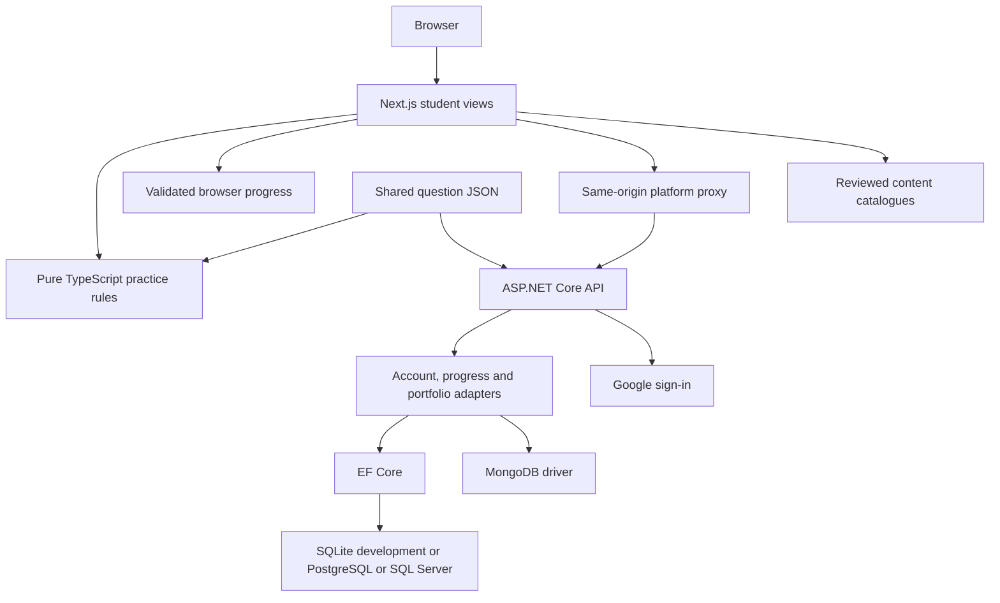

# Architecture

ProCoderJii keeps its student interface in a Next.js App Router frontend and its optional
account service in ASP.NET Core 10. Guest practice works without the backend. Both runtimes
consume one canonical question bank at `shared/practice/questions.json`.

## Runtime boundaries

The frontend owns question selection, learning feedback, and browser interaction. The backend
owns trusted account identity, persistence, antiforgery validation, and future server-owned
capabilities. The Next.js backend-for-frontend proxy keeps browser requests under the public
site origin. See [ADR 0001](decisions/0001-student-product-boundaries.md) for the decision.

| Route | Responsibility |
| --- | --- |
| `/learn` | Learner workspace, topic progress, recent sessions, and next-practice guidance. |
| `/practice` | Discover the four practice topics. |
| `/practice/[topic]` | Complete questions and review answers and explanations. |
| `/account` | Optional Google sign-in and progress/data controls. |
| `/learn/portfolio` | In-memory editor/preview, Markdown import and authenticated private-draft controls. |
| `/u/[username]` | Server-rendered published portfolio and published visibility metadata. |
| `/api/platform/*` | Next.js forwarding layer for the configured backend. |
| `/api/platform/auth/session` | Current account, account configuration status, and antiforgery token. |
| `/api/platform/signin-google` | Public Google callback forwarded to ASP.NET Core. |
| `/dashboard` | Course catalogue and reviewed note reader. |
| `/games` | Existing short reasoning and memory exercises. |

## Shared questions and learning rules

The first bank contains 24 original multiple-choice questions across quantitative aptitude,
logical reasoning, verbal ability, and programming foundations. Questions record topic,
difficulty, options, correct answer, and explanation in `shared/practice/questions.json`.
TypeScript and .NET adapters consume this file rather than maintaining independent copies.

Practice-domain code under `src/features/practice/domain/` remains independent of React,
browser storage, authentication, and payment SDKs. Session summaries are derived from selected
answers. A submitted score is never treated as trusted account data; the backend validates
question/option IDs against the shared bank.

Question IDs are part of the persistence contract. Wording corrections can retain an ID; a
semantic change needs a new ID so historical responses are not reinterpreted as a different
question. Shared-bank changes should pass both TypeScript and .NET validation tests.

## Guest and account progress

`src/features/progress/` validates untrusted attempts and maintains the latest 100 completed
sessions in browser state. Each browser store is scoped to `guest` or an authenticated account
ID. Signing in does not silently move guest history into an account; import is an explicit
student action. Browser storage failures leave practice usable with an appropriate message.

When the backend is configured, account progress can synchronize across devices. Backend
queries and mutations derive the student from the authenticated cookie and authorize access to
that account's records. Progress resets advance the account's generation; stale uploads cannot
silently restore deleted history. A stale local account snapshot is replaced on sync. This can
discard offline attempts in that snapshot, so visible history can be exported before a reset or
reconnection.

The existing `/games` exercises keep temporary round state and do not add records to the
placement-practice history.

## Optional ASP.NET Core accounts

The frontend reads `DOTNET_API_URL` only on the server. With no configured backend, free guest
practice and local progress remain available. Google client credentials are backend secrets,
configured through user-secrets for development or environment/secret management in hosting.

Google signs the student into a backend cookie session. The Google OAuth callback is the public
frontend URL `/api/platform/signin-google`, which the proxy forwards. `PublicOrigin` tells the
backend the canonical frontend origin for those redirects. The private API origin is not a
Google callback URL.

The session response supplies a CSRF token, and mutating requests send `X-CSRF-Token`. The
backend validates authentication, antiforgery state, attempt structure, and question references.
Private account responses must not be cached as public content. No privileged account credential
belongs in a browser variable.

SQLite is the local-development default. Operators can select PostgreSQL or SQL Server through
EF Core, or MongoDB through its document adapter. Account and progress endpoints depend on
storage contracts rather than a provider. MongoDB uses single-document conditional writes for
immutable sync, retention, and reset generations. Data Protection keys persist in the selected
database; deployments with replicas share that store and protect its access. Database schema
provisioning, Google setup, and production checks are documented in
[Backend setup](../backend/README.md).

The [container guide](containers.md) packages the API and starts it with one database in
separate Compose services with persistent volumes. Vercel container hosting uses an external
database. [ADR 0003](decisions/0003-container-database-options.md) records these boundaries.

## Student portfolios

Phase 1 uses one fixed field model for the form, live preview, Markdown import and both owned
themes (Simple and Developer). Rules v2 in `shared/portfolio/` define the fields, themes, limits,
username policy, and publishing age/version. TypeScript supplies editor feedback; .NET validates
trusted writes. The browser parser accepts up to 50 KiB of UTF-8 Markdown and only fills the
form. Student Markdown, HTML, CSS and JavaScript are never rendered as pages.

Guests can try an in-memory preview. A Google session is required for one saved portfolio per
account. Account changes clear private editor state. The backend controls revisions and the
draft/published/suspended state; a claimed username stays fixed while the portfolio exists.
Explicit publication copies the validated draft and search preference, so later edits cannot
change the public page until the student publishes again. Every publish requires 18+
self-declaration and current-policy acceptance; version `2026-11-11` and its confirmation time
are stored privately, with no birth date or independent age verification.

Public `/u/<username>` requests check uncached backend publication state before reading a
version-keyed, published-only snapshot cache. BFF publish/unpublish/delete invalidates the
username tag. Fresh state also hides operator-suspended pages without a cache callback.
Restoring a suspension clears the public copy and acceptance and returns a private draft;
the student must publish again. Moderation uses an operator CLI, not a public admin endpoint.

Public data excludes account IDs, Google profile data, private edits and acceptance metadata.
Themes use initials and no external image/font requests. Search is opt-in and belongs to the
published snapshot: opted-out pages are `noindex`; the fresh sitemap index includes only
currently eligible opted-in publications. Its 45,000-portfolio cap requires sitemap partitioning
before further growth. An unlisted public address can still be shared and opened.

SQLite/PostgreSQL/SQL Server store one relational portfolio row per account; MongoDB embeds it
in the account document. Shared revisions and conditional writes enforce ownership and claims.
See the [API contract](portfolio-api.md), [workspace/runbook](portfolio-workspace.md),
[Markdown guide](portfolio-markdown.md) and [ADR 0002](decisions/0002-student-portfolios.md).
Publishing defaults off; repository implementation does not establish production rollout.

## Reviewed content

Course notes, guides, and jobs use JSON catalogues pointing to repository content files. Only
registered entries are published. Validation checks slugs, dates, and safe file paths. The
renderer accepts a safe Markdown subset and rejects raw HTML, JSX, expressions, and imports;
read the [content guide](content-guide.md).

The course catalogue currently has no published subjects or notes; guides and jobs are empty.
Sample notes are intentionally unregistered. Empty pages stay out of the index and sitemap. Old
`/courses/*` paths redirect to `/dashboard/*`.

## Main areas

| Path | Responsibility |
| --- | --- |
| `src/app/` | Frontend routes, metadata, layouts, and same-origin backend proxy. |
| `src/features/practice/` | TypeScript practice rules, shared-bank adapter, and student views. |
| `src/features/progress/` | Attempt model, browser storage, and sync coordination. |
| `src/features/account/` | Frontend account API client and controls. |
| `src/features/portfolio/` | Editor/client, Markdown parser, validators, owned themes and public delivery. |
| `src/components/` | Shared shell, landing sections, and reusable UI. |
| `shared/practice/questions.json` | Canonical original practice bank used by both runtimes. |
| `shared/portfolio/` | Rules v2, publishing policy and cross-runtime fixtures. |
| `backend/src/ProCoderJi.Api/` | ASP.NET Core account API, Google auth, and EF persistence. |
| `backend/tests/` | Backend integration and validation tests. |
| `src/content/` and `src/data/` | Reviewed notes, guides, listings, and their catalogues. |
| `src/lib/` | Existing content rendering/validation, SEO, and game helpers. |
| `e2e/` | Browser interactions, synthetic fixtures, and production crawl. |
| `docs/` | Development, content, architecture, and decision guides. |

## Rendering and checks

Public practice discovery is independent of account setup. Course content enters the sitemap
only when its referenced file can be read; empty sections are `noindex`. Canonical metadata uses
`NEXT_PUBLIC_SITE_URL`, defaulting to `https://procoderji.com`. Latest videos use the public
YouTube feed only when `YOUTUBE_CHANNEL_ID` is configured.

Frontend CI checks types, domain/store behavior, content rules, production builds, desktop/mobile
flows, and real-site links/metadata. Browser CI also starts a real .NET process with isolated
SQLite persistence through the test-only `ProCoderJi.BrowserHost`, exercising the real API/BFF,
portfolio editor/publication/moderation, and Google challenge/public callback URL. Disposable
cookie authentication and loopback fixture controls exist only in that test executable; the
production API/image has no fixture login. The suite does not complete Google consent or token
exchange. Local browser checks stay frontend-only unless `E2E_DOTNET=1` is set.

CI retains failure screenshots for seven days. Backend CI restores, builds, and tests
`backend/ProCoderJi.slnx` with .NET 10 and checks PostgreSQL migrations. Controlled test
authentication requires no Google credentials; live OAuth and production deployment checks
remain operator tasks. See [Development](development.md#checks).

The backend-container workflow runs the API contract against PostgreSQL, SQL Server and MongoDB,
checks provider migrations and shared MongoDB keys, validates Compose options, and builds and
smoke-tests the non-root API image. It runs when backend, shared data, or container files change.

Portfolio launch requires a configured production API, durable storage, migrations, real Google
credentials, verified policies/reporting and operator readiness before enabling the publishing
flag. The [deployment guide](deployment.md) and
[#74](https://github.com/procoderji-com/procoderji/issues/74) describe the separate outstanding
production hosting work. Passing CI does not establish that the live service runs this commit.

Billing, checkout, and paid entitlements are not implemented. Razorpay or Paytm is a future
provider decision that also needs server-verified payment state, cancellation/support behavior,
and operational readiness. Keep payment decisions outside educational scoring rules.
