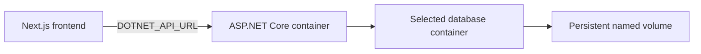

# Run the account API in containers

The Next.js frontend and the ASP.NET Core API are separate applications. The API image is built
with `backend/Dockerfile` from the **repository root**, so its shared practice questions and
portfolio rules are included. It runs as the image's non-root `app` user on port **8080**.

Choose **one database per deployment**: PostgreSQL, Microsoft SQL Server, or MongoDB. SQL Server
and PostgreSQL are relational databases; MongoDB uses the document-store implementation. SQLite
remains available for local development without Docker.

## API and database are separate containers

[Neon PostgreSQL](neon.md) is the selected hosted database. Its dedicated `compose.neon.yml`
override uses a direct connection for migrations and a pooled connection for the API.

On a development machine or a VPS, Docker Compose runs the API and the selected database on the
same Docker network. The database has its own container and a named volume. Replacing the API
image does not replace the data. The database port is not published to the host.



Bundling a database server into the API image would couple application restarts, scaling, data
storage and database upgrades. The Compose files keep those operations separate.

## Start a local stack

Install Docker with Linux containers and Docker Compose. Run all commands from the repository
root. Copy the example to an ignored local file:

```bash
cp deploy/container.env.example deploy/container.env
```

PowerShell uses `Copy-Item deploy/container.env.example deploy/container.env` instead.

MongoDB 8 needs a compatible host kernel; a container shares its host's kernel. MongoDB documents
a startup incompatibility with Linux 6.19 through 7.0.13, and some newer Ubuntu kernels also hit
its version check. The database CI job currently uses Ubuntu 22.04. Check the
[MongoDB release notes](https://www.mongodb.com/docs/manual/release-notes/8.0/) when selecting a
Linux host or upgrading MongoDB.

Set the password for the database you choose in `deploy/container.env`. This command generates
a password that meets SQL Server's complexity rules and uses characters safe in all three
example connection strings:

```bash
node --input-type=module -e "import {randomBytes} from 'node:crypto'; console.log('Aa1_'+randomBytes(32).toString('base64url'))"
```

Each override supplies its database settings to both the API and the one-time `migrate` job.
Compose waits for the database health check, runs the job, and starts the API only after that job
exits successfully. The job applies EF Core migrations for relational databases and initializes
the MongoDB indexes for MongoDB. The local example uses `API_ENVIRONMENT=Development` to allow
an HTTP loopback frontend; development startup also ensures the schema exists. In production,
set `API_ENVIRONMENT=Production` and use an HTTPS `PUBLIC_ORIGIN`. Production API startup does
not apply migrations automatically.

| Database | Values to set in `deploy/container.env` | Start command |
| --- | --- | --- |
| PostgreSQL | `POSTGRES_PASSWORD` | `docker compose --env-file deploy/container.env -f compose.yml -f compose.postgres.yml up --build -d` |
| SQL Server | `MSSQL_SA_PASSWORD`; read the license and set `MSSQL_ACCEPT_EULA=Y` | `docker compose --env-file deploy/container.env -f compose.yml -f compose.sqlserver.yml up --build -d` |
| MongoDB | `MONGO_PASSWORD` | `docker compose --env-file deploy/container.env -f compose.yml -f compose.mongodb.yml up --build -d` |

Select only one override. They deliberately use the same `api`, `migrate` and `db` service names.
Use a different Compose project name (`-p`) and `API_PORT` if you need multiple isolated stacks.

The SQL Server example runs the **Developer** edition for development and testing, on
`linux/amd64`. Production use needs an appropriate edition and license; set `MSSQL_PID`
accordingly. The example trusts SQL Server's local self-signed certificate. For a remote
production server, configure a valid certificate and certificate verification in its connection
string. The local database examples use bootstrap administrator credentials; a production API
should use a dedicated database account with the permissions it needs.

The local API is available at `http://localhost:5100`. Check its startup logs and health endpoint:

```bash
docker compose --env-file deploy/container.env -f compose.yml -f compose.postgres.yml logs migrate api
curl --fail http://localhost:5100/api/platform/health
```

Use the override you selected in every subsequent Compose command. In the separately running
Next.js app, set:

```text
DOTNET_API_URL=http://localhost:5100
```

Then start Next.js with `npm run dev`. `PUBLIC_ORIGIN` defaults to `http://localhost:3000`,
matching the frontend. To enable Google sign-in, set `GOOGLE_CLIENT_ID` and
`GOOGLE_CLIENT_SECRET` in the local container environment file and register the callback
`http://localhost:3000/api/platform/signin-google`. See [backend setup](../backend/README.md).

## Persist data and apply updates

Each database override uses a different named volume. A normal `docker compose ... down`
stops the stack and preserves it. **`down --volumes` deletes that stack's database volume**;
use it only when intentionally discarding its data. A named volume is persistence, not a backup.

When updating the application, back up the database, rebuild the image, and run the migration
job before starting updated API replicas. For example, with PostgreSQL:

```bash
docker compose --env-file deploy/container.env -f compose.yml -f compose.postgres.yml build
docker compose --env-file deploy/container.env -f compose.yml -f compose.postgres.yml run --rm migrate
docker compose --env-file deploy/container.env -f compose.yml -f compose.postgres.yml up -d api
```

Plan downtime or a compatible rolling upgrade for changes that affect running API versions.
Changing the provider selects a different database; it does **not** copy student records,
Google identities or Data Protection keys from the old provider. Plan and validate a data
migration before switching a deployment that already has students.

## Build the image for an external database

```bash
docker build --file backend/Dockerfile --tag procoderji-api:local .
```

`compose.yml` can run without a database override when the database is hosted elsewhere. Set
`DATABASE_PROVIDER`, `PLATFORM_CONNECTION_STRING`, and, for MongoDB, `DATABASE_NAME` in
`deploy/container.env`, then use `docker compose --env-file deploy/container.env up --build -d`.
Use the hosting platform's secret store for deployed Google and database credentials. The
container's temporary filesystem is not used to persist student data or Data Protection keys.

Compose publishes the API on **127.0.0.1** for local use. A Vercel frontend cannot reach your
laptop's `localhost`. For a VPS deployment, configure a reachable HTTPS endpoint or private
network connection and set the frontend's server-only `DOTNET_API_URL` to that origin. Set the
API's `PUBLIC_ORIGIN` to the exact HTTPS frontend origin; the Google callback stays on the
frontend at `/api/platform/signin-google`. Set `API_ENVIRONMENT=Production` for the deployed API.

## Vercel containers use an external database

These Compose database services are for Docker hosts with persistent volumes. Vercel's
container runtime does not turn this Compose stack into a persistent database host. Deploy the
API image using the platform's container configuration, set its listening port to `8080`, and
connect it to an externally hosted PostgreSQL, SQL Server or MongoDB service. Run the migration
or index-initialization command as a separate release operation before enabling API traffic.

The opt-in [vercel.backend.json](../vercel.backend.json) uses Vercel's Container service with
`root: "."` and `entrypoint: "backend/Dockerfile"`. The repository root is essential because the
build needs `global.json` and `shared/`. Its catch-all rewrite serves the API; this configuration
is for a **separate backend Vercel project**, not the existing Next.js project. Container Runtime
and Services are currently beta features.

1. Use a separate checkout or worktree for a dedicated backend project. Create the project
   with `vercel project create procoderji-api --scope YOUR_TEAM` if it does not exist, then link
   it explicitly with `vercel link --yes --project procoderji-api --scope YOUR_TEAM`. A plain
   `vercel link` can select the frontend project from the Git remote. Set the backend project's
   Root Directory to the repository root. A separate checkout keeps its local `.vercel` project
   link apart from the frontend's link.
2. Set these values in the backend project's environment settings:

   | Variable | Value |
   | --- | --- |
   | `PORT` and `ASPNETCORE_HTTP_PORTS` | `8080` |
   | `ASPNETCORE_ENVIRONMENT` | `Production` |
   | `PublicOrigin` | Exact HTTPS frontend origin, for example `https://procoderji.com` |
   | `Database__Provider` | `Postgres`, `SqlServer` or `MongoDb` |
   | `ConnectionStrings__Platform` | The external database connection string, with provider-appropriate TLS |
   | `Database__Name` | Database name when using MongoDB |
   | `Database__MigrateOnStartup` | `false` |
   | `Authentication__Google__ClientId` and `Authentication__Google__ClientSecret` | Backend Google OAuth secrets |

3. Run the migration/index initializer against that external database from a release runner
   that can reach it. For example, after injecting the listed backend variables into that
   runner's environment:

   ```bash
   docker run --rm --env Database__Provider --env ConnectionStrings__Platform --env Database__Name --env PublicOrigin procoderji-api:local --migrate
   ```

4. In the **backend-only checkout**, copy the optional configuration to `vercel.json` so the
   remote build reads the service configuration, then deploy from the repository root. Preserve
   any existing `vercel.json` before copying:

   ```bash
   cp vercel.backend.json vercel.json
   vercel deploy --project procoderji-api --scope YOUR_TEAM --prod
   ```

   In PowerShell, use `Copy-Item vercel.backend.json vercel.json`. Keep this generated
   `vercel.json` local to the backend checkout; committing its catch-all API rewrite to the
   shared branch would change frontend deployments. Keep the repository's `.vercelignore` in
   place: Git ignore rules alone do not exclude all local operator files from Vercel CLI uploads.

5. Set the frontend project's server-only `DOTNET_API_URL` to the backend's reachable HTTPS
   origin, redeploy the frontend, and verify the callback and account flows. Deployment
   Protection must allow the frontend's server requests to reach the backend. The OAuth
   callback remains on the frontend origin; do not register the backend URL as the callback.

The optional configuration is an operator template; no Vercel project is created or changed by
committing it. Verify the deployed API's health, session endpoint, Google redirect and database
connectivity before enabling frontend account traffic. A successful build alone does not
establish that the container serves requests.

The repository does not provision a cloud account, a database, DNS or Google credentials. A
successful image build or CI check does not verify live Google consent in the deployed system.

## References

- [Docker: containerized databases and persistent volumes](https://docs.docker.com/guides/databases/)
- [Docker Compose: startup order and migration dependencies](https://docs.docker.com/compose/how-tos/startup-order/)
- [Microsoft: .NET container images and the non-root app user](https://learn.microsoft.com/en-us/dotnet/core/docker/)
- [Vercel: moving Compose services and volumes to Vercel](https://vercel.com/i/can-you-run-docker-compose-on-vercel)
- [Vercel: Container Runtime](https://vercel.com/docs/functions/runtimes/container)
- [Vercel: Service configuration](https://vercel.com/docs/services/config-reference)
